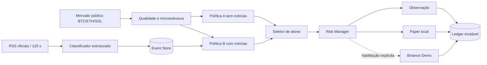

# Arquitetura implementada

`phase6_news.py` contém os contratos de fonte e evento, parser RSS/Atom limitado, classificador conservador, detecção de instruções maliciosas, SQLite com deduplicação/revisões, rate limiting, retries e scheduler sem sobreposição.

`phase6_trading.py` contém snapshots tipados, filtro de elegibilidade, cálculo explícito de custos, ranking de ativos, risco independente, duração, prorrogação, paper broker, adapter Binance Demo, ledger geral e avaliação pareada.

`phase6.py` compõe três coletores públicos reutilizados, o serviço de notícias e os componentes operacionais. Importar o módulo não inicia rede nem ordens. `scripts/run_phase6.py` fornece comandos explícitos.

`Phase6DecisionEngine` avalia A e B no mesmo snapshot, registra todas as oportunidades e abstenções em um único registro encadeado e, somente quando construído explicitamente com `mode="paper"`, encaminha a melhor oportunidade B aprovada pelo risco ao broker local. A Binance Demo não faz parte dessa rota automática.

Fluxo:

