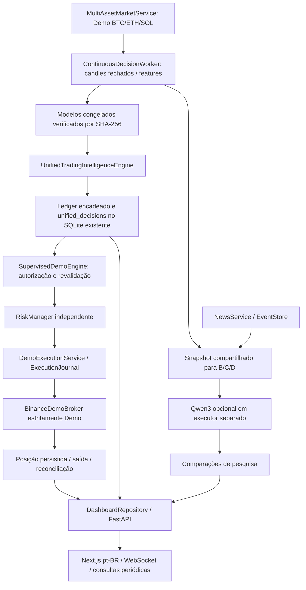

# Auditoria, arquitetura e limpeza

## Diagnóstico anterior

O supervisor da Fase 6.1 já executava mercado, notícias, observação e executor. A correção anterior havia isolado a política A do Qwen3, mas mantinha dois workers carregando modelos, fazendo warmup REST e construindo features. O executor consultava diretamente as avaliações de pesquisa A, cuja regra principal de 1 minuto e veto econômico não eram a política experimental de 5 minutos. Isso produzia duas interpretações de “decisão”.

O dashboard misturava prontidão legada da política D, indicadores fixos de bloqueio e estado real da Fase 6.4. Um saldo em cache podia ser apresentado como disponível após falha REST. A página Saúde consultava um smoke histórico para o WebSocket. A CPU era amostrada por um novo objeto psutil a cada chamada, retornando repetidamente o primeiro zero sem uma janela válida.

A verificação final também encontrou uma incompatibilidade de heartbeat: o supervisor emitia a cada 30 segundos, mas a Inteligência considerava vencido após 15 segundos. A publicação da plataforma agora é de cinco segundos e o contrato informa seu intervalo. A API respeita esse intervalo, inclusive para registros anteriores de 30 segundos. Um teste verifica que dados realmente vencidos continuam bloqueados. Os zeros antigos de CPU não foram apagados; não são evidência confiável de CPU ociosa, pois o método anterior não tinha a janela necessária.

## Fluxo consolidado

Cada seta é uma integração de código existente. O Qwen3 e a tela não estão no caminho de acompanhamento de posições. O supervisor mantém executores separados para inferência quantitativa, notícias opcionais e posições.

## Responsabilidades e situação

| Componente | Situação / justificativa |
|---|---|
| ingestion/features/labeling/training/validation/backtesting, Fases 1–5 e scripts de livros/Colab | Pesquisa e reprodução histórica preservadas; não autorizam ordens |
| phase4_live/prospective/inference | Observador histórico preservado; não inicia um segundo executor na plataforma atual |
| microstructure/live_market | Coleta real e integridade de trades/livro; modelo de microestrutura não promovido |
| FourPolicyEngine / AssetSelector | Comparações A/B/C/D preservadas; não são interfaces de execução |
| ContinuousDecisionWorker quantitativo | Único warmup, feature engineering e registry operacional de modelos |
| ContinuousDecisionWorker de notícias | Reutiliza o snapshot publicado; não recebe outra assinatura de mercado nem carrega modelos; sem fila ilimitada de ciclos antigos |
| UnifiedTradingIntelligenceEngine | Única proposta operacional; um especialista congelado, contexto de pesquisa sem veto/promoção implícita |
| SupervisedDemoEngine / RiskManager | Consome apenas propostas centrais, verifica sessão e controles independentes; persiste risco antes da ordem |
| DemoExecutionService / BinanceDemoBroker | Reutilizados; nenhum novo cliente Binance |
| SQLite / ledgers / EventStore | Preservados; nova tabela no SQLite de avaliações, sem conversão destrutiva |
| Kronos e Qwen3 | Kronos somente pesquisa; Qwen3 somente interpretação contextual, não probabilidade de preço |
| NewsService / Phase61Supervisor | Em uso; tarefas supervisionadas e lock de instância única |

## Código retirado do fluxo ativo

- Segundo warmup REST, segundo conjunto de pesos e segunda construção de features no worker de notícias.
- Assinatura duplicada de eventos para esse worker; ele consome o snapshot compartilhado.
- Leitura direta de avaliações antigas pelo executor: ausência de `unified_decisions` bloqueia entradas, sem fallback silencioso.
- Prontidão legada da política D e indicadores fixos na Inteligência/menu lateral.
- Leitura de smoke histórico como saúde atual do WebSocket.
- Repetição imediata de chamadas de saldo após erro; o cache agora respeita o intervalo e sinaliza indisponibilidade.

Nenhum arquivo de pesquisa foi excluído: os scripts continuam referenciados por reprodução, testes ou auditoria. Não foi constatada uma dependência externa seguramente removível; nenhuma foi removida por suposição. As implementações públicas de pesquisa permanecem disponíveis, mas o supervisor atual usa somente o fluxo consolidado. Não há remoção de datasets, relatórios, modelos ou livros.

O diff Git registra a reversão de código. Os bancos foram copiados pelo mecanismo SQLite backup antes do reinício; logs foram preservados em `runtime/phase_6_4/recovery_backups/phase642-logs-*`. Reverter código exige OBSERVE e ausência de posições; nunca restaurar um banco antigo sobre ordens posteriores.
